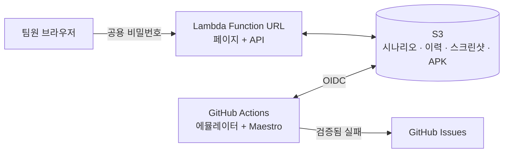

# Safori QA

Safori 안드로이드 앱의 실제 사용 흐름을 자동으로 확인하는 QA 도구입니다.

테스트 코드로는 앱을 처음부터 끝까지 써 보는 흐름을 확인할 수 없습니다. 그래서 시나리오를 웹 콘솔에 글로 적어 두면, 에뮬레이터가 매일 밤 앱을 직접 눌러 보고 결과를 남깁니다. 시나리오는 개발자가 아니어도 등록하고 고칠 수 있습니다.

- **시나리오 등록·수정·조회:** QA 콘솔 (주소와 비밀번호는 팀 내부 채널 공지 참고)
- **실행:** 매일 02:10 KST, 새 APK 업로드 시, 또는 개발자가 Actions에서 수동 실행
- **결과:** QA 콘솔의 실행 이력과 실패 스크린샷
- **티켓:** 이 레포의 [`qa-fail` 이슈](https://github.com/safori-team/safori-qa/issues?q=is%3Aissue+label%3Aqa-fail)

> **현재 상태:** 초기 구축 단계입니다. 아래 [처음 설정하기](#처음-설정하기)가 끝나야 실제로 동작하고, 에뮬레이터 실행은 아직 실제 앱으로 검증하지 않았습니다.

## 콘솔 사용법

### 시나리오 등록하기

1. QA 콘솔에 팀 공용 비밀번호로 로그인합니다.
2. **새 시나리오**를 누르고 이름과 수정자를 입력합니다.
3. 단계를 한 줄에 한 동작씩 씁니다. 형식이 틀리면 입력창 아래에 어느 줄이 틀렸는지 바로 표시되고, 고칠 때까지 저장할 수 없습니다.
4. 저장하면 **초안**이 되고, 다음 실행부터 돌아갑니다.

### 단계 쓰는 법

첫 줄은 항상 로그인입니다. 시나리오의 역할과 앱이 이 줄로 정해집니다.

| 역할 | 실행하는 앱 | 테스트 계정 |
|---|---|---|
| 어르신 | 사포리 | 어르신 |
| 보호자 | 사포리 관리자 | 보호자 |
| 관리자 | 사포리 관리자 | 담당자 |

```text
로그인 보호자
보임 "오늘의 감정"
누르기 "주간 리포트"
기다리기 "이번 주" 10
안보임 "오류"
```

| 쓰는 법 | 뜻 |
|---|---|
| `로그인 보호자` | 그 역할의 테스트 계정으로 로그인합니다 (어르신 · 보호자 · 관리자) |
| `누르기 "주간 리포트"` | 그 글자가 있는 버튼이나 항목을 누릅니다 |
| `보임 "이번 주"` | 화면에 그 글자가 있어야 통과합니다 |
| `안보임 "오류"` | 화면에 그 글자가 없어야 통과합니다 |
| `입력 "메모" "안녕하세요"` | 그 칸을 누르고 글자를 입력합니다 |
| `기다리기 "분석 완료" 30` | 그 글자가 나올 때까지 최대 30초 기다립니다 |
| `스크롤` | 아래로 한 번 내립니다 |
| `뒤로` | 뒤로 갑니다 |
| `# 메모` | 실행하지 않는 메모입니다 |

**좋은 시나리오를 쓰는 팁**

- 앱 화면에 보이는 글자를 그대로 씁니다. 띄어쓰기까지 같아야 합니다.
- 마지막에는 `보임`으로 결과를 꼭 확인합니다. 누르기만 있으면 화면이 잘못되어도 통과합니다.
- 분석 결과처럼 늦게 나오는 화면은 `보임` 대신 `기다리기`를 씁니다.
- 시나리오 하나에는 흐름 하나만 넣습니다.

### 상태

| 상태 | 뜻 | 실패하면 |
|---|---|---|
| **초안** | 새로 만들었거나 단계를 고친 시나리오 | 콘솔에만 표시 |
| **검증됨** | 초안이 실행에서 한 번 통과한 시나리오 | 콘솔 표시 + GitHub 이슈 생성 |
| **중지** | 잠시 실행하지 않는 시나리오 | 실행 안 함 |

검증됨은 직접 고를 수 없습니다. 통과하면 자동으로 바뀌고, 검증됨 시나리오의 단계를 고치면 다시 초안으로 돌아갑니다.

### 결과

| 결과 | 뜻 | 할 일 |
|---|---|---|
| **통과** | 끝까지 문제없이 실행됨 | 없음 |
| **실패** | 실행 중 멈춤. 스크린샷과 원인이 콘솔에 남음 | 스크린샷을 보고 앱 문제인지 시나리오 문제인지 판단 |
| **형식오류** | 단계 형식이 틀려서 실행하지 못함 | 시나리오 수정 |
| **미실행** | 아직 실행 전 | 다음 실행을 기다림 |

자주 있는 일: 앱 문구가 바뀌면 앱이 멀쩡해도 실패합니다. 이때는 시나리오의 글자를 고쳐 주세요.

## 개발자 안내

### 구조



상시 켜진 인스턴스가 없습니다. Lambda는 요청이 있을 때만 돌고, 실행은 public 레포의 GitHub Actions 표준 러너에서 합니다. AWS 리소스는 SAFORI-Server의 `infra/shared/qa.tf`에 있습니다.

| 경로 | 역할 |
|---|---|
| `shared/steps.js` | 단계 파서와 YAML 변환. 콘솔·Lambda·러너가 같은 파일을 씁니다 |
| `shared/store.js` | S3 JSON 저장. ETag 조건부 쓰기로 동시 수정을 처리합니다 |
| `lambda/handler.js` | 페이지, API, 로그인 |
| `web/index.html` | 콘솔 화면 (빌드 없음) |
| `scripts/run.js` | 시나리오 실행, 결과 기록, 이슈 생성 |
| `maestro/common/login.yaml` | 역할 공용 로그인 흐름 |
| `.github/workflows/qa.yml` | 시나리오 실행 |
| `.github/workflows/deploy.yml` | Lambda 코드 배포 |

S3 키는 다음과 같습니다.

| 키 | 내용 |
|---|---|
| `scenarios.json` | 시나리오 전체와 마지막 결과 |
| `runs/{id}.json` | 시나리오별 실행 이력 (최근 50건) |
| `screenshots/{id}/*.png` | 실패 스크린샷 (30일 뒤 자동 삭제) |
| `apk/user.apk` | 사포리 앱 (`user-dev` 빌드) |
| `apk/care.apk` | 사포리 관리자 앱 (`care-dev` 빌드) |

### 로컬 테스트

S3를 메모리로 대체한 테스트입니다. AWS 계정이 필요 없습니다.

```bash
npm ci && npm test
```

### 처음 설정하기

1. SAFORI-Server `infra/shared`를 apply하고 출력값 `qa_bucket`, `qa_console_url`, `qa_ci_role_arn`을 확인합니다.
2. 이 레포의 Settings → Secrets and variables → Actions에 아래 값을 넣습니다.

   | Secret | 값 |
   |---|---|
   | `AWS_ROLE_TO_ASSUME` | `qa_ci_role_arn` 값 |
   | `QA_BUCKET` | `qa_bucket` 값 |
   | `QA_ACCOUNTS` | `{"어르신":{"id":"...","pw":"..."},"보호자":{...},"관리자":{...}}` (관리자 = 담당자 계정) |

3. Actions에서 `deploy` 워크플로우를 수동 실행해 Lambda 코드를 배포합니다.
4. 콘솔 비밀번호를 정합니다. 이 명령은 Lambda 환경변수를 통째로 바꾸므로 `QA_BUCKET`도 같이 넣어야 합니다.

   ```bash
   aws lambda update-function-configuration --function-name safori-qa --environment "Variables={QA_BUCKET=<qa_bucket 값>,QA_PASSWORD=$(openssl rand -hex 24)}"
   ```

   비밀번호는 Lambda 콘솔에서 확인해 팀에 공유합니다. 설정 전에는 아무도 로그인할 수 없습니다.

5. 두 앱의 APK를 올리고 Actions에서 `qa`를 수동 실행합니다. 둘 다 alpha를 보는 dev 빌드입니다.

   ```bash
   aws s3 cp user-dev.apk s3://<qa_bucket 값>/apk/user.apk
   aws s3 cp care-dev.apk s3://<qa_bucket 값>/apk/care.apk
   ```

### 프론트엔드 연동

- 두 앱의 dev APK를 빌드할 때 `apk/user.apk`, `apk/care.apk`로 올린 뒤 `repository_dispatch`(`apk-uploaded`, `client_payload.apk_version`)를 보내면 바로 실행됩니다. 업로드 권한은 프론트 레포 이름이 정해지면 추가해야 합니다.
- 주요 버튼에 `testTag`/resource-id를 붙이면 문구 변경에 덜 깨집니다. 지금 문법은 화면 글자만 찾기 때문에, 도입할 때 문법도 함께 넓혀야 합니다.

### public 레포 규칙

이 레포는 Actions 비용을 없애려고 public으로 운영합니다. 코드, 실행 로그, 이슈를 누구나 볼 수 있습니다.

- 로그에는 시나리오 번호와 결과만 남깁니다. Maestro 출력은 버리고, 상세 내용은 S3에만 저장합니다.
- 이슈에는 시나리오 이름과 번호만 적습니다. 스크린샷, 화면 내용, 콘솔 주소를 넣지 않습니다.
- 콘솔 주소, 버킷 이름, 계정 정보, 테스트 계정을 커밋하지 않습니다. 모두 Secrets에 둡니다.
- `pull_request` 트리거를 추가하지 않습니다. 외부 PR이 Secrets나 AWS role에 닿으면 안 됩니다.
- AWS role은 main 브랜치 실행만 쓸 수 있습니다.
- 단계에 `${`를 쓰지 못하게 막았습니다. Maestro가 이를 코드로 평가해 테스트 계정을 읽을 수 있기 때문입니다.

### 의도적으로 뺀 것

| 뺀 것 | 대신 | 다시 넣을 때 |
|---|---|---|
| 개인 계정 (Cognito) | 공용 비밀번호, 수정자 직접 입력 | 개인별 권한이나 수정 이력이 필요할 때 |
| DB | S3 JSON 파일 | 시나리오가 수백 개를 넘거나 동시 수정이 잦을 때 |
| 콘솔의 "지금 실행" 버튼 | Actions 수동 실행 | 비개발자가 직접 실행해야 할 때 |
| 로그인 시도 제한 | 긴 임의 비밀번호 | 비밀번호를 사람이 외워서 쓰게 될 때 |
| 시나리오 삭제 | 중지 상태 | 목록이 지저분해질 때 |
| 이슈 자동 닫기 | 사람이 확인 후 닫기 | 이슈가 쌓여 관리가 어려울 때 |
